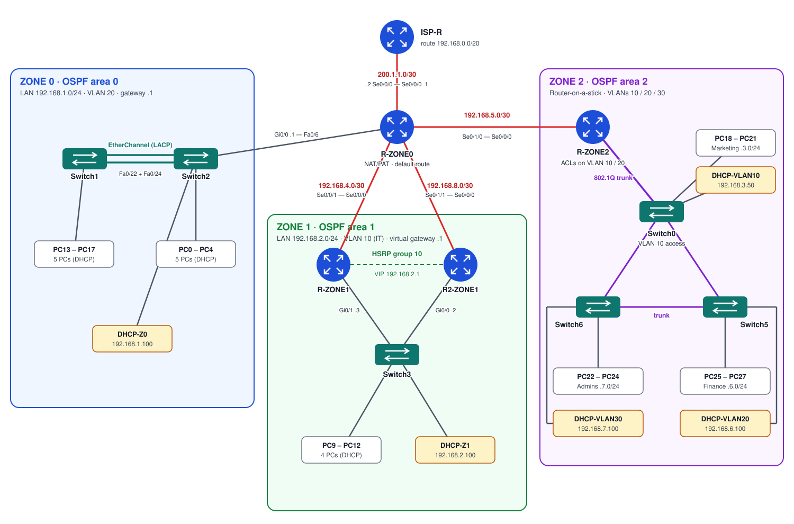

# CCNA Project 1: Multi-Zone Enterprise Network


A Cisco Packet Tracer network that connects **three zones** to a simulated ISP, combining multi-area routing, gateway redundancy, VLAN segmentation, traffic filtering and NAT.



## At a Glance

| Routers | Switches | DHCP servers | PCs | Links |
|:---:|:---:|:---:|:---:|:---:|
| 5 (Cisco 2911) | 6 (Catalyst 2960) | 5 | 24 | 42 |

## Features

| Technology | Where | Purpose |
|---|---|---|
| OSPF multi-area (0, 1, 2) | All internal routers | Dynamic routing between zones |
| HSRP (group 10) | R-ZONE1, R2-ZONE1 | Redundant default gateway for Zone 1 |
| EtherChannel (LACP) | Switch1 ↔ Switch2 | Two links bundled into one |
| VLANs and 802.1Q trunks | Switches | Layer 2 segmentation |
| Router-on-a-stick | R-ZONE2 | Inter-VLAN routing |
| Extended named ACLs | R-ZONE2 | Isolate Marketing from Finance |
| NAT overload (PAT) | R-ZONE0 | Share one outside address |
| Static and default routing | R-ZONE0, ISP-R | Path to and from the ISP |
| DHCP | One server per subnet or VLAN | Automatic PC addressing |

## Addressing Plan

### Router interfaces

| Device | Interface | IP address | Mask | OSPF area |
|---|---|---|---|:---:|
| ISP-R | Se0/0/0 | 200.1.1.2 | /30 | none |
| R-ZONE0 | Se0/0/0 (to ISP) | 200.1.1.1 | /30 | none |
| R-ZONE0 | Gi0/0 | 192.168.1.1 | /24 | 0 |
| R-ZONE0 | Se0/0/1 | 192.168.4.1 | /30 | 0 |
| R-ZONE0 | Se0/1/0 | 192.168.5.1 | /30 | 0 |
| R-ZONE0 | Se0/1/1 | 192.168.8.1 | /30 | 0 |
| R-ZONE1 | Se0/0/0 | 192.168.4.2 | /30 | 0 |
| R-ZONE1 | Gi0/1 | 192.168.2.3 | /24 | 1 |
| R2-ZONE1 | Se0/0/0 | 192.168.8.2 | /30 | 0 |
| R2-ZONE1 | Gi0/0 | 192.168.2.2 | /24 | 1 |
| HSRP virtual IP | group 10 | 192.168.2.1 | /24 | 1 |
| R-ZONE2 | Se0/0/0 | 192.168.5.2 | /30 | 0 |
| R-ZONE2 | Gi0/0.10 | 192.168.3.1 | /24 | 2 |
| R-ZONE2 | Gi0/0.20 | 192.168.6.1 | /24 | 2 |
| R-ZONE2 | Gi0/0.30 | 192.168.7.1 | /24 | 2 |

### LANs and DHCP

| Zone | VLAN | Network | Gateway | DHCP server | Pool range | PCs |
|---|---|---|---|---|---|---|
| 0 | 20 (ADMINS) | 192.168.1.0/24 | .1 | DHCP-Z0 (.100) | .2 – .255 | PC0–PC4, PC13–PC17 |
| 1 | 10 (IT) | 192.168.2.0/24 | .1 (virtual) | DHCP-Z1 (.100) | .10 – .109 | PC9–PC12 |
| 2 | 10 (MARKETING) | 192.168.3.0/24 | .1 | DHCP-VLAN10 (.50) | .2 – .51 | PC18–PC21 |
| 2 | 20 (FINANCE) | 192.168.6.0/24 | .1 | DHCP-VLAN20 (.100) | .2 – .51 | PC25–PC27 |
| 2 | 30 (ADMINS) | 192.168.7.0/24 | .1 | DHCP-VLAN30 (.100) | .2 – .51 | PC22–PC24 |

Each subnet has its own DHCP server, so no `ip helper-address` is needed.

## Switch Ports

| Switch | Zone | Access ports | Trunk ports |
|---|:---:|---|---|
| Switch1 | 0 | Fa0/1–5 (VLAN 20) | Fa0/22, Fa0/24 (Port-channel1) |
| Switch2 | 0 | Fa0/1–6, Fa0/23 (VLAN 20) | Fa0/22, Fa0/24 (Port-channel1) |
| Switch3 | 1 | Fa0/1–6, Fa0/24 (VLAN 10) | none |
| Switch0 | 2 | Fa0/3–7 (VLAN 10) | Fa0/1, Fa0/2, Fa0/24 |
| Switch5 | 2 | Fa0/3–5, Fa0/24 (VLAN 20) | Fa0/1, Fa0/2 |
| Switch6 | 2 | Fa0/3–5, Fa0/24 (VLAN 30) | Fa0/1, Fa0/2 |

Switch0, Switch5 and Switch6 form a triangle, so PVST+ blocks one path per VLAN to prevent loops while keeping a backup. See the full [cabling table](docs/cabling.md).

## Key Configuration

### OSPF and default route (R-ZONE0)

```cisco
router ospf 1
 router-id 1.1.1.1
 passive-interface GigabitEthernet0/0
 network 192.168.1.0 0.0.0.255 area 0
 network 192.168.4.0 0.0.0.3 area 0
 network 192.168.8.0 0.0.0.3 area 0
 network 192.168.5.0 0.0.0.3 area 0
 default-information originate
!
ip route 0.0.0.0 0.0.0.0 200.1.1.2
```

| Router | Router ID | Areas |
|---|---|---|
| R-ZONE0 | 1.1.1.1 | 0 |
| R-ZONE1 | 2.2.2.2 | 0, 1 |
| R2-ZONE1 | 3.3.3.3 | 0, 1 |
| R-ZONE2 | 4.4.4.4 | 0, 2 |

### NAT overload (R-ZONE0)

```cisco
access-list 1 permit 192.168.0.0 0.0.15.255
ip nat inside source list 1 interface Serial0/0/0 overload
!
interface Serial0/0/0
 ip nat outside
! Gi0/0, Se0/0/1, Se0/1/0 and Se0/1/1 are "ip nat inside"
```

### HSRP (Zone 1)

```cisco
! R-ZONE1
interface GigabitEthernet0/1
 ip address 192.168.2.3 255.255.255.0
 standby 10 ip 192.168.2.1

! R2-ZONE1
interface GigabitEthernet0/0
 ip address 192.168.2.2 255.255.255.0
 standby 10 ip 192.168.2.1
```

### Router-on-a-stick and ACLs (R-ZONE2)

```cisco
interface GigabitEthernet0/0.10
 encapsulation dot1Q 10
 ip address 192.168.3.1 255.255.255.0
 ip access-group MARKETING-IN in
!
interface GigabitEthernet0/0.20
 encapsulation dot1Q 20
 ip address 192.168.6.1 255.255.255.0
 ip access-group FINANCE-IN in
!
interface GigabitEthernet0/0.30
 encapsulation dot1Q 30
 ip address 192.168.7.1 255.255.255.0
!
ip access-list extended MARKETING-IN
 deny ip 192.168.3.0 0.0.0.255 192.168.6.0 0.0.0.255
 permit ip any any
ip access-list extended FINANCE-IN
 deny ip 192.168.6.0 0.0.0.255 192.168.3.0 0.0.0.255
 permit ip any any
```

### EtherChannel (Switch1 and Switch2)

```cisco
interface range FastEthernet0/22, FastEthernet0/24
 switchport trunk allowed vlan 20
 switchport mode trunk
 channel-group 1 mode active
```

Full device configurations are in [`configs/`](configs/).

## How to Run

1. Install **Cisco Packet Tracer 8.2.2** or newer.
2. Clone the repository:
   ```bash
   git clone https://github.com/mohamed-bensakar/CCNA-Project-01.git
   ```
3. Open `CCNA-Project-01.pkt` and wait for the links to come up.
4. On each PC, check that DHCP assigned an address (`ipconfig`).
5. Follow the [verification guide](docs/verification.md).

## Repository Structure

```text
CCNA-Project-01/
├── README.md
├── CCNA-Project-01.pkt
├── configs/          # running-config of every router and switch
├── docs/
│   ├── cabling.md
│   ├── verification.md
│   └── improvements.md
└── images/
    └── topology.svg
```

## Roadmap

Planned hardening and cleanup is listed in [docs/improvements.md](docs/improvements.md).

## Author

**Mohamed Bensakar** · Networking | Linux | Cybersecurity
GitHub: [@mohamed-bensakar](https://github.com/mohamed-bensakar)
